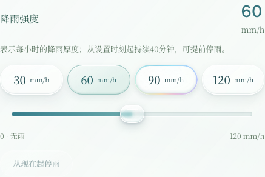

## 液态玻璃视觉分支（5.14.4）

5.14.4：桌面端使用左侧常驻玻璃侧边栏，六个栏目显示图标和宋体名称，底部保留事件记录入口；主内容拥有独立列。手机使用五项悬浮玻璃导航，直接进入水利知识；完整菜单仍提供关于作品。选中项为随路由移动的独立玻璃胶囊，指针按压沿用RGB边缘色散与彩色高光，键盘/减少动态时不移动。900px切换导航形式，保留焦点、inert、菜单关闭与安全区域。

5.14.3：按钮、分段选择、雨强预设及原生滑条统一为圆润玻璃控件。使用方向高光、接触与环境阴影；按压立即响应，Chromium以独立RGB背景位移产生边缘色散，WebKit/Firefox使用磨砂与彩色高光回退。滑块随原生输入连续移动，拖动轻微浮起；保留宋体、键盘、焦点、禁用状态及减少动态/透明和高对比回退。手机雨强按钮双列。

5.14.2：液态玻璃版电脑与手机均恢复自托管宋体。首页“南京实景 / 水利知识”移除共用照片底纹与浑浊色块，改为清透紧凑入口；电脑双列，560px及以下单列，整卡点击和历史/文章弹层保持正常。仅更新codex/liquid-glass及独立站 https://apsonchian.ltd/zhishui-glass/ 。

5.14.1功能修复已包含在独立液态玻璃站点：https://apsonchian.ltd/zhishui-glass/ 。AI切换到已验证的兼容视觉接口，换图/取消/超时后可重新识别，图片读取10秒、整个流程45秒。降雨推演直接标明横纵轴、单位和图例，提供观察地点选择；修改雨强保留时间与闸门，停雨保留当前播放/暂停状态。主站 https://apsonchian.ltd/zhishui/ 同步功能修复并保留原视觉。

当前分支：`codex/liquid-glass`，独立发布至 https://apsonchian.ltd/zhishui-glass/ 。`main`保留原视觉并同步功能修复；旧版本36137a8仍保存在仓库历史中。

首页、知识列表、水情与实验面板、图片识别区及弹层共用透明卡片材质，使用真实背景模糊、柔和边缘高光与较轻的环境阴影。少量入口卡片在已验证的 Chromium 环境中增加 SVG 背景边缘位移；WebKit、Firefox 使用 CSS 模糊玻璃回退。读数和正文不经过滤镜，密集内容使用更稳定的底色。

移除首页重复线稿、彩色封面和分色卡片；标题改为“南京河湖 / 水情与观察”，统一使用自托管宋体（电脑与手机）。指定的开场引导语、真实照片、AI分析和教学模型保持原有内容。无新增依赖或常驻动画。

导航预览：[手机界面](docs/liquid-navigation-mobile.png)。可选回归：`npm run check:navigation`，支持`GLASS_BROWSER=webkit`或`firefox`。

控件预览（按压状态）：

可选控件回归：`npm run check:controls`，支持`GLASS_BROWSER=webkit`或`firefox`。

本地运行：`npm run dev`，打开 `http://127.0.0.1:5188/`。关闭材质的回退可由系统减少透明/提高对比度偏好触发，或设置根节点 `data-glass-effects="off"`。本机浏览器与移动视口验证记录见 `qa/VERIFICATION.md`。

## 5.10.0 动态告警与铃铛

当前发布 `20261103-reading-index-v42`（5.13.2）：水利知识改为紧凑的双列阅读列表，手机单列；移除重复插画与独立“阅读全文”栏，每篇使用覆盖整条的原生按钮打开文章。分类、搜索、数量反馈与空结果恢复保留，pH搜索忽略大小写。污染源标记支持鼠标和键盘打开释放信息，断面入口标明“地图定位”并将地图带入视野。无地图时移除无效定位入口，未载入时控件禁用；没有图像框的AI说明改为普通文章内容。指北针改为静态方向标识。

当前发布 `20261103-context-cards-v41`（5.13.1）：看水情每个工作区增加用途和操作说明，明确读数单位、教学阈值、推演时间和核查含义。地点对比、数据表改为独立页面；地点资料、读数解释、图层、推演规则、污染参数和模型、记录详情及图片来源改为弹出卡片，打开时保持主页面尺寸和滚动位置，关闭回到原按钮。查看说明自动暂停推演；对比切换地点后返回总览，水域、地图和读数保持一致。

## 看水情统一工作区（5.13.0）

1. 默认水情总览：选择水域和地点，读数卡与地图、趋势同步。手机先展示关键读数，再显示地图。地图不再重复弹出整张详情卡。地点资料与跨地点比较按需展开，当前数据来源明确为初始教学读数或某一时刻的降雨推演结果。
2. 降雨推演：默认准备60mm/h；选择30/60/90/120预设后保持0分钟，点击播放才开始。改变雨强滑块或闸门仍按原规则只改当前时刻以后的过程，玻璃圆钮保留1%步长。切换水域重置本轮，湖泊不显示闸门。切换工作区暂停推演。结果中的地图定位会返回总览并选中相应地点。
3. 污染扩散：沿用三条河段与12小时模型，卡片和控件改用同一套样式。生成的断面事件通过底部入口进入统一事件记录，原独立污染记录列表已合并。
4. 事件记录：可筛选全部、水位预警、照片巡检、污染推演。水位/巡检可定位、处置和撤销；污染事件可恢复当时河段、参数和时间查看。导出包含全部三类记录；清空污染记录只作用于该分类，不删除水位和巡检记录。

较早演示说明中“简洁/详细视图”、同一页向下查找降雨、选预设即自动推进15分钟及污染独立记录列表均为历史行为。

当前发布 `20261103-monitor-workspace-v40`（5.13.0）：看水情整理为水情总览、降雨推演、污染扩散、事件记录四个工作区。总览用水域/地点选择、地图与单一读数卡、变化趋势组织内容；降雨预设只设置参数，点击播放才推进时间。污染、水位与照片巡检记录统一分类、回溯及导出。手机先显示关键读数，卡片、按钮、图表与留白统一。

当前发布 `20261103-glass-controls-v39`（5.12.1）：降雨推演雨强预设改为30/60/90/120mm/h四个胶囊按钮，选中为浅青绿底与描边。虚拟闸门滑块采用52px半透明圆钮、中央竖线与柔和阴影，轨道填充与百分比同步，开度可逐1%调整。键盘、触摸及历史回放沿用原生range。

## GIS污染扩散演示（5.12.0）

1. 进入「看水情」后切换「污染扩散」，或直接打开上述链接。默认外秦淮河东南段，释放质量300kg、流速0.4m/s、弥散系数8m²/s、等效断面180m²、半衰期6小时、教学阈值1mg/L。
2. 将时间轴移到60分，地图显示彩色浓度带经过断面一；右侧/下方同步给出河段内峰值、超阈长度、剩余质量和沿程曲线。断面一首次达到教学阈值约40分、模型峰值约51分。
3. 调整流速或弥散系数，时间回到0分，观察到达时间和峰值变化；展开高级参数可比较衰减与阈值。点击「在地图上设释放点」，再点选河段附近，释放点会沿折线吸附；也可直接用释放位置滑块。
4. 点击任意断面标题定位地图，点击「河段全景」复位；可切换秦淮新河入江段或长江南京城区段。观察断面是沿程位置，不是实测站。
5. 时间轴移到720分，查看超阈与回落记录；回退后再次前进不重复记账。记录刷新保留，导出记录包含全部保留事件与参数快照。
6. 「导出GIS分析」下载标准GeoJSON：河段、释放点、三个断面、当前超阈河段及模型参数/单位/质量平衡。系统减少动态时默认静止；播放中进入后台、切工作区或切页会停止播放。

当前发布 `20261103-pollution-gis-v38`（5.12.0）：看水情新增「水情监测 / 污染扩散」两个工作区。污染扩散提供三条真实河道、地图点击设源、质量/流速/弥散/断面/衰减/阈值参数、12小时回放、沿程浓度曲线、三个虚拟断面的到达与峰值分析、40条本机事件记录及GeoJSON导出。模型、流向和断面均为教学设定。入口：https://apsonchian.ltd/zhishui/#/monitor?tool=pollution 。

当前发布 `20261103-discovery-pair-v37`：南京实景入口改为浅青绿渐变、桥梁水纹线稿，与水利知识卡片共用浅色底、淡线稿和相同图文布局。照片保留在实景列表中，长江大桥、夫子庙、玄武湖的历史卡片仍可打开。

当前发布 `20261103-river-handoff-v36`：点击「进入平台」后，引导页原有河流持续保留；文字先退场，河流在1800ms内缩小、移向首页河流位置，与首页河流交叠淡化。跳过、键盘、减少动态、后台或无动画API时直接进入；中途按键、缩放窗口或切页会完成过渡并清理覆盖层。刷新后可重新查看。下列 v35 的独立淡入已由本次连续衔接替代。

最新发布 `20261103-river-entry-v35`：引导界面进入首页后，河流以1400ms透明度淡入，场景容器保持稳定。首次进入播放，返回首页不重播；键盘、减少动态和无动画API时直接显示。刷新页面后可重新查看开场衔接。

最新发布 `20261102-navigation-lab-v34`（5.11.0）：去掉泛化引导和强制步骤。水文体验提供四参数径流实验、三种地面对比、六组参数记录、八地点地图与分照片观察记录，支持保存、迁移和导出。桌面导航五项、手机底栏四项，菜单顺序统一，撤掉右侧重复导航。下列较早版本中的三步流程、进度和双导航描述为历史行为。

最新发布 `20261102-ai-samples-v33`：AI例图从2张增加到6张，新增长江桥梁、玄武湖面、溪流瀑布、海岸水面；缩略图可切换预览并查看署名，点击开始识别才发送所选图片。

最新发布 `20261102-card-covers-v32`：首页入口混用秦淮夜景、水下照片、暖金书页、深青和浅蓝渐变；保持既有卡片位置和交互。封面照片署名与许可可从页脚地图与影像来源查看。

最新发布 `20261102-home-priority-v31`：首页看水情设为主入口，水文体验为次入口；南京实景和水利知识并排上移，长江大桥、夫子庙、玄武湖收进实景列表，可继续阅读历史并返回列表。

最新发布 `20261102-knowledge-entry-v30`：南京河湖实景照片下方新增一张水利知识入口卡片，整卡可点击进入知识库；电脑与手机均采用图标、标题并排布局。

最新发布 `20261102-river-stories-v29`：知识文章取消统一跨栏目跳转；首页三张实景可打开历史介绍卡片并查看资料来源；看水情新增简短介绍。单段开场原文已在线上逐字核对，浏览器与资源验收通过。

首页最新更新：三张入口卡片的图标与标题并排，图标放大、移除说明正文；河流图更新为无网格细缝的平滑地形、深青河道与浅色岸线。已发布 `20261102-home-refinement-v28`。

当前开场为作者指定的单段引导语，点击「进入平台」直接进入；已移除段落切换和首页标题下的简介。已于 2026-11-02 发布 `20261102-opening-single-v27`，下列旧版本中的两段开场描述为历史记录。

1. 刷新进入开屏，只有跳过，没有暂停动画；进入首页也无暂停动态入口，数字江河默认流动。
2. 看水情模拟暴雨→暂停推演→前进10分钟，新告警列表显示水位、超出幅度与定位。预警图标、地点圆标和地图圆标慢闪轻跳，数字保持稳定。三类水域均使用相同规则；湖泊可把雨强调到120mm/h、推进至55分钟观察演示超阈。
3. 点铃铛，标记待处理记录已处置：红点随剩余数量变化，全部处理后消失。撤销处置后恢复；刷新保持结果。可用全部标记已处置，逐条撤销。
4. 数据暂停不停止装饰动效；系统减少动态为静态告警，后台暂停。处置记录不会伪造水位恢复。

## 5.9.0 导航与知识页

顶部、右侧与手机展开菜单均为相同六栏目、相同顺序。顶部点水利知识或关于作品可直接进入；从侧边切换后顶部高亮同步。知识页不再有分类与搜索/知识文章目录，分类按钮、搜索与整卡阅读保留。

## 5.8.0 说明与图片信息

AI页展开使用说明：电脑标题24px/正文20px，手机22px/18px。照片下方默认只显示图片信息入口，展开可看原图、作者与许可；收起后恢复简洁。首页三张照片和实景观察同样默认收起，上传文件名保留。无需运行识别即可验收。

## 5.7.0 地图与模拟预警

1. 看水情上方预警区显示超阈地点，点击秦淮新河口，地图直接聚焦并打开详情。点击水情详情跳到读数，AI巡检进入已关联地点的识别页。
2. 模拟暴雨→暂停→前进10分钟，内秦淮河达到模拟高位；预警区、点位与列表共同变红并显示双叹号/文字。点击预警条定位，再回到全景查看全水域。
3. 点击当前水域的河线可定位最近的教学点。滚动放大后可见已有地理数据中的道路/地标名称；街道图和本地水系图可切换。
4. 手机点位点击留在地图；弹窗完整显示，打开时收起可能遮挡文字的缩放/指北控件，关闭后恢复。连续点同一标记、关闭后再点均能打开。
5. 键盘Tab到点位，Enter或Space打开；数据更新不重建标记焦点节点。系统减少动态时预警圈静态显示。以上均为教学预警，不是官方水情。

## 5.6.0 降雨推演

1. 看水情点击模拟暴雨，直接定位到推演区，起点已响应。选择30/60/90mm/h预设可重开一轮。
2. 暂停后调大虚拟闸门，点击前进10分钟：起点水位逐渐降低，灰色虚线给出同场降雨未调节的对照。点击后续地点看延迟响应，地图/读数同步。
3. 点击现在停雨；起点逐步回落，后续地点仍可能上涨。预设雨在40分钟自动停止。拖动时间轴回看，控制开度与雨强显示对应时刻的值。
4. 在当前时间修改雨强或开度，只改该控制的未来；重选预设重新开始，重置恢复基线并保留历史台账。
5. 切换南京湖泊：两座湖泊独立缓慢蓄退水，不显示虚拟闸门。所有读数和曲线均为教学模拟。

手机固定底栏12px黑体；页脚快速导航电脑16px/手机15px黑体。其他正文与字号保持。

## 5.5.0 字号与小字精简

查看首页、知识库、水情和AI页：主要标题、卡片正文、按钮与监测读数放大，重复简介及装饰性小字减少。电脑仍为宋体，手机为黑体；320px下控件换行、读数和AI示例单列。开屏两段全文、模拟标识、单位及来源保留。

## 5.4.0 文案

首页用具体动作介绍地图、模拟与图片分析；导航统一为水文体验。知识库以概念命名文章，仍可整卡打开。体验流程为河口定位→降雨比较→实景观察，按钮名称与实际动作一致。关于页保留原分节链接，内容改为功能、数据说明与分工。作者指定的开屏两段文字和主标语未改。

## 5.3.1 电脑右侧快捷导航

用1024px及以上窗口打开平台，右侧显示六个栏目和返回顶部；当前栏目实心圆高亮。鼠标悬停或键盘Tab聚焦显示名称，Enter可直接切换。向下滚动后点击最下方箭头返回顶部。缩小至手机宽度后隐藏并移出焦点顺序，底部导航保留。

## 5.3.0 链接与页脚

首页下滑查看「水情与河湖」；三张卡分别进入水情、识别和体验。页面底部快速导航包含六个栏目，点击当前栏目返回页首，其他栏目正常切换。作品说明定位到关于页的实现范围，标题保留在固定导航下方；键盘同样可用。地图与影像来源打开原生详情弹窗，数据下载直接指向本地水系文件。页签、开屏、页头、页脚共享河流标识。

## 5.2.0 两幕开屏

完整刷新任意平台网址，先看到「金陵水脉」及第一段引言；点击继续阅读后看到「以数护水」和第二段，可上一段或进入平台。跳过开场和Esc均可直接进入，保留原网址目标栏目；站内切页不重播，重新完整刷新会再次显示。不倒计时或自动推进。暂停控制不妨碍阅读和进入；系统减少动态时静态呈现。手机390/320px可完整阅读，无横向溢出。

## 5.1.0 首页动效验收

打开首页，观察上游到下游的渐隐流线、水面折射和三处监测涟漪。点击暂停后画面静止，再点继续恢复；向下滚动，体验入口与实景卡片仅首次入场。鼠标点击入口切换页面，键盘操作直接响应。系统开启减少动态时呈现完整静态地形。电脑宋体、手机黑体保持，手机使用同一流域场景与底栏。

# 5.0.1补充验收路径

知识库：直接点击卡片图片、标题或正文打开手记；搜索pH后用键盘Enter阅读。手机保持与桌面相同卡片、按钮及信息层级，保留黑体、底栏和响应式列数。水情点位横滑选择，完整状态符号可见。

---
# 5.0答辩路径：观察—推演—核查—记录

1. 打开看水情，默认公众体验；点击首屏一键暴雨，看到起点先变化，后续地点延迟响应。
2. 暂停并拖动时间轴到60分钟；展开虚拟闸门，调高开度，观察起点回落与流量增加，再向后拖动，观察后续响应。均为教学规则。
3. 切换运维演示，选择另一地点，比较距各自阈值的曲线；表格点选与地图同步。点击地图标记查看小趋势。
4. 从地点进入关联AI巡检，运行内置水下照片；结果生成后展开记入巡检台账，选择地点、勾选需人工核查并保存。返回水情，在台账查看、定位、标记处置/撤销，或导出。
5. 重置恢复8个地点初始读数，保留历史台账。刷新会结束旧推演，台账在此浏览器保留。非水域照片只提示换图，不能保存为巡检结果。

勿将教学等级称为官方预警，勿将示例照片称为关联地点实拍，勿将虚拟闸门称为现实控制。

---
历史演示路径：

# 4.5.1新增演示

上传一张明确不含水域的普通物品/截图，点击识别：仅见换张水域照片提示，无分析、框、导出。点击试试水下示例，开始识别后正常展示观察。手机完成后自动定位结果。

---
# 当前演示路径（4.5.0）

1. 首页进入新手体验，定位地点、比较雨水去向、可选填写观察。
2. 看水情：选择地点，放大地图后点击“回到全景”，确认范围恢复和成功提示；切换街道图与水系图。水位读数仍为模拟。
3. AI识别：选择水下实拍图，点击开始识别，等候结果；对照原图，点击结果卡片查看对应估计框。换秦淮河实拍，确认观察随图片变化。也可上传自己的非敏感照片。
4. 导出AI观察记录，JSON含文字与估计坐标，不含图片。取消等待、更换图片、离开页面均不发布过期结果；网络失败可重试。

点击开始后才发送图片。照片署名保留，识别结果不用于水质或设施安全判断。

---
以下为旧版本演示记录，AI模拟流程已被4.5真实识别替换。

# 三分钟演示路径（4.4）

正式入口：https://apsonchian.ltd/zhishui/#/home

1. 首页点击“开始新手体验”。主导航只有首页、看水情、识别演示、新手体验四项，知识和作品介绍在页尾。
2. 第一步点“在地图上找到三汊河口”，看见真实水系中的入江口；点击下一步。
3. 第二步点“开始比较这场雨”，直接看到同样雨量下硬化地面与更多绿地的差异；点击下一步。雨量与计算方法可以按需展开。
4. 第三步看一张实景照片，文字可选；点“完成体验”，再保存记录。
5. 打开“看水情”，从列表点一个地点，地图与读数一起变化；点“试一下：水位上涨会怎样？”，观察点位和状态变红，再恢复演示前水位。
6. 需要时展开变化曲线或更多数据；街道图可从地图上方按需打开。
7. 打开“识别演示”，直接点“开始演示”；框选结果出现后点目标卡片查看对应位置。更换图片、筛选和导出为可选操作。

说明：地图坐标、水系线和历史照片有真实来源；地图线宽是视觉表达。水位/流量/pH、阈值和识别标注均为前端教学模拟。雨水比较为简化模型，不可用于实际防汛、水质或设施判断。
