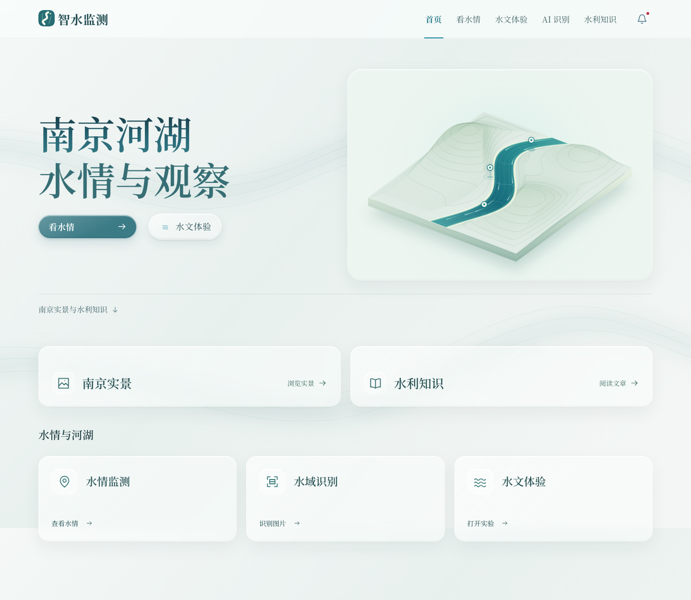
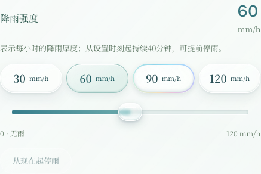

# 智水未来 · 智水监测（独立新站）

5.14.3：按钮、分段选择、雨强预设及原生滑条统一为圆润玻璃控件。使用方向高光、接触与环境阴影；按压立即响应，Chromium以独立RGB背景位移产生边缘色散，WebKit/Firefox使用磨砂与彩色高光回退。滑块随原生输入连续移动，拖动轻微浮起；保留宋体、键盘、焦点、禁用状态及减少动态/透明和高对比回退。手机雨强按钮双列。

5.14.2：液态玻璃版电脑与手机均恢复自托管宋体。首页“南京实景 / 水利知识”移除共用照片底纹与浑浊色块，改为清透紧凑入口；电脑双列，560px及以下单列，整卡点击和历史/文章弹层保持正常。仅更新codex/liquid-glass及独立站 https://apsonchian.ltd/zhishui-glass/ 。

5.14.1功能修复已包含在独立液态玻璃站点：https://apsonchian.ltd/zhishui-glass/ 。AI切换到已验证的兼容视觉接口，换图/取消/超时后可重新识别，图片读取10秒、整个流程45秒。降雨推演直接标明横纵轴、单位和图例，提供观察地点选择；修改雨强保留时间与闸门，停雨保留当前播放/暂停状态。主站 https://apsonchian.ltd/zhishui/ 同步功能修复并保留原视觉。

## 液态玻璃视觉分支（5.14.3）

当前分支：`codex/liquid-glass`，独立发布至 https://apsonchian.ltd/zhishui-glass/ 。`main`保留原视觉并同步功能修复；旧版本36137a8仍保存在仓库历史中。

首页、知识列表、水情与实验面板、图片识别区及弹层共用透明卡片材质，使用真实背景模糊、柔和边缘高光与较轻的环境阴影。少量入口卡片在已验证的 Chromium 环境中增加 SVG 背景边缘位移；WebKit、Firefox 使用 CSS 模糊玻璃回退。读数和正文不经过滤镜，密集内容使用更稳定的底色。

移除首页重复线稿、彩色封面和分色卡片；标题改为“南京河湖 / 水情与观察”，统一使用自托管宋体（电脑与手机）。指定的开场引导语、真实照片、AI分析和教学模型保持原有内容。无新增运行依赖或常驻动画。



控件预览（按压状态）：



可选控件回归：`npm run check:controls`，支持`GLASS_BROWSER=webkit`或`firefox`。

本地运行：`npm run dev`，打开 `http://127.0.0.1:5188/`。关闭材质的回退可由系统减少透明/提高对比度偏好触发，或设置根节点 `data-glass-effects="off"`。本机浏览器与移动视口验证记录见 `qa/VERIFICATION.md`。可选像素回归：启动预览后运行 `npm run check:glass`（需Playwright及其Chromium浏览器）。


当前发布 `20261103-reading-index-v42`（5.13.2）：水利知识改为紧凑的双列阅读列表，手机单列；移除重复插画与独立“阅读全文”栏，每篇使用覆盖整条的原生按钮打开文章。分类、搜索、数量反馈与空结果恢复保留，pH搜索忽略大小写。污染源标记支持鼠标和键盘打开释放信息，断面入口标明“地图定位”并将地图带入视野。无地图时移除无效定位入口，未载入时控件禁用；没有图像框的AI说明改为普通文章内容。指北针改为静态方向标识。

当前发布 `20261103-context-cards-v41`（5.13.1）：看水情每个工作区增加用途和操作说明，明确读数单位、教学阈值、推演时间和核查含义。地点对比、数据表改为独立页面；地点资料、读数解释、图层、推演规则、污染参数和模型、记录详情及图片来源改为弹出卡片，打开时保持主页面尺寸和滚动位置，关闭回到原按钮。查看说明自动暂停推演；对比切换地点后返回总览，水域、地图和读数保持一致。

当前发布 `20261103-monitor-workspace-v40`（5.13.0）：看水情整理为水情总览、降雨推演、污染扩散、事件记录四个工作区。总览用水域/地点选择、地图与单一读数卡、变化趋势组织内容；降雨预设只设置参数，点击播放才推进时间。污染、水位与照片巡检记录统一分类、回溯及导出。手机先显示关键读数，卡片、按钮、图表与留白统一。

当前发布 `20261103-glass-controls-v39`（5.12.1）：降雨推演雨强预设改为30/60/90/120mm/h四个胶囊按钮，选中为浅青绿底与描边。虚拟闸门滑块采用52px半透明圆钮、中央竖线与柔和阴影，轨道填充与百分比同步，开度可逐1%调整。键盘、触摸及历史回放沿用原生range。

当前发布 `20261103-pollution-gis-v38`（5.12.0）：看水情新增「水情监测 / 污染扩散」两个工作区。污染扩散提供三条真实河道、地图点击设源、质量/流速/弥散/断面/衰减/阈值参数、12小时回放、沿程浓度曲线、三个虚拟断面的到达与峰值分析、40条本机事件记录及GeoJSON导出。模型、流向和断面均为教学设定。入口：https://apsonchian.ltd/zhishui/#/monitor?tool=pollution 。

当前发布 `20261103-discovery-pair-v37`：南京实景入口改为浅青绿渐变、桥梁水纹线稿，与水利知识卡片共用浅色底、淡线稿和相同图文布局。照片保留在实景列表中，长江大桥、夫子庙、玄武湖的历史卡片仍可打开。

当前发布 `20261103-river-handoff-v36`：点击「进入平台」后，引导页原有河流持续保留；文字先退场，河流在1800ms内缩小、移向首页河流位置，与首页河流交叠淡化。跳过、键盘、减少动态、后台或无动画API时直接进入；中途按键、缩放窗口或切页会完成过渡并清理覆盖层。刷新后可重新查看。下列 v35 的独立淡入已由本次连续衔接替代。

最新发布 `20261103-river-entry-v35`：引导界面进入首页后，河流以1400ms透明度淡入，场景容器保持稳定。首次进入播放，返回首页不重播；键盘、减少动态和无动画API时直接显示。刷新页面后可重新查看开场衔接。

最新发布 `20261102-navigation-lab-v34`（5.11.0）：去掉泛化引导和强制步骤。水文体验提供四参数径流实验、三种地面对比、六组参数记录、八地点地图与分照片观察记录，支持保存、迁移和导出。桌面导航五项、手机底栏四项，菜单顺序统一，撤掉右侧重复导航。下列较早版本中的三步流程、进度和双导航描述为历史行为。

最新发布 `20261102-ai-samples-v33`：AI例图从2张增加到6张，新增长江桥梁、玄武湖面、溪流瀑布、海岸水面；缩略图可切换预览并查看署名，点击开始识别才发送所选图片。

最新发布 `20261102-card-covers-v32`：首页入口混用秦淮夜景、水下照片、暖金书页、深青和浅蓝渐变；保持既有卡片位置和交互。封面照片署名与许可可从页脚地图与影像来源查看。

最新发布 `20261102-home-priority-v31`：首页看水情设为主入口，水文体验为次入口；南京实景和水利知识并排上移，长江大桥、夫子庙、玄武湖收进实景列表，可继续阅读历史并返回列表。

最新发布 `20261102-knowledge-entry-v30`：南京河湖实景照片下方新增一张水利知识入口卡片，整卡可点击进入知识库；电脑与手机均采用图标、标题并排布局。

最新发布 `20261102-river-stories-v29`：知识文章取消统一跨栏目跳转；首页三张实景可打开历史介绍卡片并查看资料来源；看水情新增简短介绍。单段开场原文已在线上逐字核对，浏览器与资源验收通过。

首页最新更新：三张入口卡片的图标与标题并排，图标放大、移除说明正文；河流图更新为无网格细缝的平滑地形、深青河道与浅色岸线。已发布 `20261102-home-refinement-v28`。

当前开场为作者指定的单段引导语，点击「进入平台」直接进入；已移除段落切换和首页标题下的简介。已于 2026-11-02 发布 `20261102-opening-single-v27`，下列旧版本中的两段开场描述为历史记录。

正式服务器地址：[https://apsonchian.ltd/zhishui/](https://apsonchian.ltd/zhishui/)。已公开部署到作者自己的服务器，部署记录与更新方法见 [SERVER_DEPLOYMENT.md](SERVER_DEPLOYMENT.md)。

智联千川，AI 护水利。面向网页设计大赛的独立数字水利可视化作品。

本目录是方向三的完整独立项目，拥有自己的页面、脚本、资源、运行命令与源码包。没有修改或复用方向二的应用入口、服务端、数据库和发布配置。可将本目录整体移动到任意位置运行。

## 当前版本：默认动态与预警处理（5.10.0）

首页和开屏移除暂停动态/动画入口，默认呈现动态；装饰动效与模拟数据的暂停状态分离。降雨推演播放/暂停、时间轴及暂停刷新仍保留，支持观察数据。后台、离屏和系统减少动态继续生效。

预警卡片改为计数+告警列表，直接显示地点、当前水位、超出幅度与定位。秦淮河、长江、湖泊所有超阈/高位点，列表图标、地点圆标和地图图标使用2.8秒慢闪轻跳；名称与读数不位移。预警列表和地图图标在数值更新时保留节点，不反复重启动画；手机选中的地点会在横滑容器内自动露出。

铃铛红点改由全区域待处理记录统计，处理后熄灭，撤销/新事件/等级升级后恢复，刷新保留结果。已结束或无需核查记录不计入待处理。新增可逐条撤销的全部标记已处置，处理后同步弹窗与主台账。修正快速重建台账时记录ID可能重复的问题。处理表示事件已记录处置，水位等级仍按模拟读数判断。

以下为延续的导航一致性与知识页精简说明：

顶部导航与电脑右侧导航统一使用同一份完整栏目配置，名称与顺序均为：首页、看水情、AI识别、水文体验、水利知识、关于作品。手机展开菜单同步补齐六项；保留原手机常用底栏。点击任一导航切换后，两处当前栏目状态同步。

水利知识页移除「分类与搜索 / 知识文章」页内目录，标题后直接进入分类、搜索和文章卡片。已有章节ID与定位属性保留，兼容旧链接。桌面通过共享间距和不换行保持六项清晰可读；窄屏菜单可独立滚动。

以下为延续的说明字号与图片信息说明：

AI使用说明标题24px、正文20px；手机标题22px、正文18px，并修正旧样式覆盖正文为12px的问题。地点资料、推演规则与计算方法等折叠说明同步增强阅读层级。

AI、首页实景和体验照片下方的长摄影行默认收起为「图片信息」，按需展开查看作品原图标题、作者、许可与展示修改说明。保留原照片及必要署名，减少默认画面信息量；用户上传的文件名仍正常显示。正文/导航字体、识别行为及后端不变。

以下为延续的地图交互与模拟预警说明：

扩大地图主视区，选中地点读数移到地图下方；1200px窗口中地图由约546px增加至800px。保留本地真实水系与道路/公园背景，放大后显示已有数据中的道路和地标名称。街道图使用在线底图的岸线，避免用示意江面遮住真实街道信息；本地水系仍可独立使用。

新增模拟预警区，按教学等级和超出幅度排列地点，点击直接定位并打开水位、阈值差和趋势。模拟高位使用红色、双叹号和文字标签，选中也保留等级颜色；点位、地点列表、预警区和读数同步。名称按可见范围与碰撞情况避让，选中点和超阈点优先显示。

手机点地图留在原位置，由地图内部平移容纳详情；水情详情按钮可明确跳到读数区，AI巡检保留地点关联。重复点击、关闭后重开、全景恢复与键盘Space均可用。实时更新保留标记的焦点节点，弹窗操作获焦时不替换其内容；只在预警成员或等级变化时播报简短状态。保留暂停、后台与减少动态的预警动效控制。手机底栏仍为12px黑体。

以下为延续的降雨推演与底部导航说明：

底部导航使用黑体：手机固定底栏12px，页脚快速导航电脑16px/手机15px，其余正文仍保持电脑宋体、手机黑体。

降雨推演新增30/60/90mm/h三种预设，默认从教学第15分钟开始展示已发生的响应；降雨40分钟自动停止，可立即停雨或自定义雨强。时间轴支持回放、播放/暂停、前进10分钟与重置。雨强和闸门变化按操作时刻记录，回看或修改当前控制不会重写此前过程。

教学响应改为逐分钟平滑蓄退水，湖泊变化更慢，河道保留分支/先后时滞与衰减。虚拟闸门逐步生效，后续地点延迟承接变化；它不是水力预报或现实设备控制。控制区旁展示选中地点水位过程、阈值与较初始差值，调闸后显示同场降雨未调节的虚线对照和差值；手机上下排列且曲线无需横向滚动。既有地图、表格、图表和台账同步保留。

以下为延续的字号与阅读层级：

统一放大主要标题、正文与控件：卡片标题26px、正文18px、操作按钮17px，页面标题38px（手机34px）；监测读数40px（手机36px）。电脑宋体与手机黑体保持。图表刻度和提示同步放大。

删去重复的栏目简介、体验步骤小字、照片地名重复说明、装饰性栏目标签和开屏底部重复句；保留完整两段开屏引言、数据单位、教学模拟标识、影像署名、隐私与识别局限。手机控件允许换行，320px下读数单列、AI示例单列，优先保证大字可读。

以下为延续的页面与交互说明：

固定页面文案改为简短的功能、操作和内容说明。统一使用「水文体验」；体验步骤改为河口定位、降雨比较、实景观察；知识文章使用水位与流量、水库的调蓄作用等具体标题。关于页直接说明功能、数据与制作分工，去掉隐喻式标题和反复鼓励语。作者指定的两段开屏引言与主标语保持原文。

本轮只改固定文字、栏目标题和导出记录名称，数据字段、路由、互动流程、AI网关和模型不变。原有模拟数据、来源、隐私与识别局限说明保留。

电脑宽度1024px及以上显示右侧胶囊形快捷导航，六个栏目与返回顶部均为实际入口。当前栏目实心圆高亮，鼠标悬停或键盘聚焦显示名称；复用站内原生路由与回顶逻辑。正文预留88px右侧空间，地图与内容不被遮挡，页脚背景保持全宽。窄屏隐藏并设为inert，手机仍使用原底部导航；开屏期间随平台整体隐藏。

首页入口改为「水情监测 / 水域识别 / 水文体验」，移除问答式引导和重复推荐语。新增深青色三栏页脚：作品标识、六个栏目导航、来源与数据下载；手机保留同一结构与底部导航。页签、页头、开屏及页脚统一使用新的河流SVG标识。

修复当前栏目链接地址未变化时不返回页首的问题，同章节链接支持重新定位和键盘焦点；锚点留出固定导航高度。跨栏目链接保持原生路由，修饰键、新标签页、下载与外部链接不被截获。站内路由切换会关闭已打开的详情弹窗。

首次完整载入网页先展示两幕开屏「金陵水脉 / 以数护水」，完整保留作者提供的两段引言，以流动河线、柔和涟漪和标题入场展开。访客自行继续/上一段/进入，也可跳过或按Esc；不自动翻页、不存储已读状态，刷新重新展示，站内换页不会重复开场。

开屏是独立页面区域，底下的平台初始hidden，进入后才启动路由、首页场景及数据定时器。保留原目标栏目与站点参数；支持暂停、后台停动、减少动态、键盘即时切换，退出清理监听与动画。

首页改为带明暗、等高线与层叠侧面的立体概念流域；水面以连续渐隐流线和折射波纹表达流向，三处监测信号使用缓慢涟漪。地形与等高线缓存，只有水面和信号逐帧绘制；30fps、DPR上限1.5，离屏/后台/暂停/减少动态均停止场景循环。

首屏标题按70ms间隔入场，操作按钮在140ms后开始出现；下方体验与实景卡片仅在首次进入视野时轻抬淡入。换页保持80ms退出/200ms进入并支持打断，卡片悬停与按钮按压有短反馈。键盘、暂停和减少动态跳过入场；水情读数和图表不加位移动画。

全站27处字符箭头已换为统一单色SVG图标，包括相关水域、知识卡片、资料来源、下一步/下载、示例与沙盘连接。图标跟随文字颜色，不依赖字体或系统emoji；桌面与手机使用同一套图标。

手机与电脑共享卡片圆角、标题/正文层级、按钮规格与状态样式，保留电脑宋体/手机黑体。窄屏主要改变列数与间距；点位卡保留完整横向样式并横滑选择，底部导航保留。知识库整张卡片可点击图片、标题、正文或留白打开手记，每卡仍只有一个原生阅读按钮，支持键盘和搜索后动态结果。

默认公众体验突出地图、教学状态与一键暴雨；运维演示展开趋势对比、事件台账和点位表。8个地点新增档案与关联科普，地图、地点列表和表格共享选中状态；点位弹窗展示读数、小趋势和AI巡检入口。

沙盘支持0—120mm/h雨强、0—120分钟压缩教学时间、播放/暂停/定位回放、重置与虚拟调节闸。秦淮河起点到两个出口使用分支时滞示意，长江使用先后响应，两个湖泊独立。模型确定性计算，拖动到同一时刻得到相同结果，不依赖随机等待。闸门只存在于演示模型中，不连接现实设备。

四种教学状态：平稳、临近阈值、模拟超阈、模拟高位；同时使用颜色、符号和文字，不称官方预警。河道色彩随教学状态变化，河流/预警/湖泊图层可切换。两个地点对比距各自阈值差值，避免混用不同水位基准。

从地点可直接关联真实AI图像观察，非水域拦截保留。用户选择关联地点、确认是否需人工核查后，才将文字观察记入本机台账。模型观察不自动认定现场危险；内置示例不是该地点实时或现场照片。台账支持处置、撤销、定位、导出，最多保存50条；不保存图片。刷新结束旧推演，保留历史记录。

电脑宋体、手机黑体、浅色与原有首页动画保留；预警涟漪缓慢，支持暂停、后台与减少动态。详见SOURCES.md、DEMO.md和qa/VERIFICATION.md。

## 启动

安装 Python 3 即可，无需 npm install、后端服务或 API 密钥。

```sh
cd /Users/aotelei/coding/web_design_contest/zhishui-live
python3 -m http.server 5188 --bind 127.0.0.1 --directory dist
```

打开 http://127.0.0.1:5188/ 。已有 Node.js 时也可执行 `npm run dev`（仍需 Python）。部署到静态服务器时直接使用 `dist/` 的全部内容，支持子目录与哈希路由。

## 页面与交互

- 平台首页 `#/home`：动态河流示意背景、运行指标、流域地图、实时趋势与事件。
- 监测总览 `#/monitor`：8 个真实地点上的教学点、3 类真实水域；地图点选、悬停详情、站点表格与曲线联动；水位、流量、pH 与 1H / 6H / 24H 切换；暂停/继续刷新；水位上涨预警、恢复与事件记录；当前区域 CSV 导出。
- AI 水下识别 `#/ai`：两类实拍照片、上传与拖入图片；真实AI图像分析、可取消等待、框与卡片联动、原图对照及JSON记录导出。仅点击开始后发送分析。
- 水利知识库 `#/knowledge`：6 篇基础概念手记，支持分类、关键词搜索、阅读弹窗与演示跳转。
- 守水体验 `#/experience`：三步引导、真实地图任务、简化雨水实验、照片观察、本机进度与记录导出。
- 方案与团队 `#/about`：方案路径、实现范围与团队角色示例。成员姓名待作者填写。

响应式布局包含四项桌面导航、手机收起菜单与四项固定底栏；支持键盘操作、对话框 Esc 关闭、系统减少动态设置及后台暂停数据刷新。

## 模拟边界

地图位置和水系几何来自真实公开地理资料；点位是教学定位，不代表正式水文站。所有数值、点位编号与预警阈值均为前端模拟，不代表真实水文监测。每 3 秒更新模拟观测，时间范围为合成历史曲线的展示窗口。初始秦淮新河口教学点预设一条持续水位预警；“恢复常态”恢复上涨演示前的基线，保留该初始预警。

水质仅展示模拟 pH，不依据单一指标给出水质类别或饮用安全判断。“正常”状态仅指模拟水位未超过本作品的演示阈值。

AI 页通过独立私有网关调用视觉模型，根据图片生成结果；有使用次数限制与并发保护。密钥位于服务器/etc/zhishui/vision.env（0600），不进入网页、源码包或日志。静态本地预览未配置网关时会明确提示不可用。

## 文件

```text
dist/index.html                  页面外壳
dist/assets/style.css            基础响应式样式
dist/assets/cinematic.css        科幻视觉与动效
dist/assets/river-scene.js       数字河流场景与生命周期
dist/assets/app.js               页面、模拟数据与交互逻辑
dist/assets/interface.css        全站字阶、布局与导航
dist/assets/ai-workbench.css     AI视觉工作台样式
dist/assets/ai/                  原创生态与设施教学示意图
dist/assets/page-transition.js   可中断的页面切换动画
dist/assets/vendor/chart.umd.js  Chart.js 4.4.9（本地）
dist/assets/dm-sans.woff2         英文数字字体（本地）
scripts/check.mjs                数据与交互状态检查
scripts/package.py               独立源码压缩包生成
DEMO.md                          3 分钟演示路径
qa/                              本地截图与验收记录
```

图表与字体均在本地，不依赖 CDN。概念数字河流、知识插画和水下示意图为本项目代码绘制；实际地图来自署名OSM数据，照片使用各自CC许可；电脑端使用本地宋体，手机使用系统黑体。Chart.js 与字体许可位于 `dist/assets/vendor/`。

## 验证与打包

```sh
npm run check
npm run package
```

检查覆盖模拟数据更新、暂停和后台行为、区域 CSV、预警与恢复、AI 演示生命周期、替换图片取消标注、上传格式与大小校验，以及本地资源完整性；新增水系湖泊闭环、照片许可/摘要、雨水水量守恒、控制变量、输入边界和本地存储失败检查；额外检查场景暂停/继续、离屏与后台暂停、减少动态、DPR 上限、缩放不重复调度、销毁清理与无 Canvas 回退。源码包为本目录下 `zhishui-future-source.zip`，不含历史项目、Git 元数据、云站点身份或用户图片。

本地版本创建于 2026 年 10 月 29 日。


## 独立新站

本目录根据“上线，用新网站”的要求，从已验证的科幻版复制而来，拥有独立站点身份、源码仓库和网址。原 zhishui-future 站点及项目保留。各版本独立更新；本次只更新作者服务器的 /zhishui/，没有重新发布旧Sites副本。

## 私有识图网关

后端：backend/server.py（Python标准库），只监听127.0.0.1:5192；Nginx只转发固定识图和健康路径。最多2个并发任务、每IP每小时20次、全局滚动24小时200次。计数使用加盐IP哈希持久化，不保存图片；客户端取消只停止等待，已发出的云端任务可能继续。

使用deploy/install-ai.py部署代码与deploy/zhishui-ai.service，失败回滚。先由管理员在服务器私有环境文件中配置VISION_API_KEY，勿放入dist。网关健康仅检查配置已加载，真实推理需另行验收。

检查：npm run check；python3 -m unittest discover -s backend -v。
